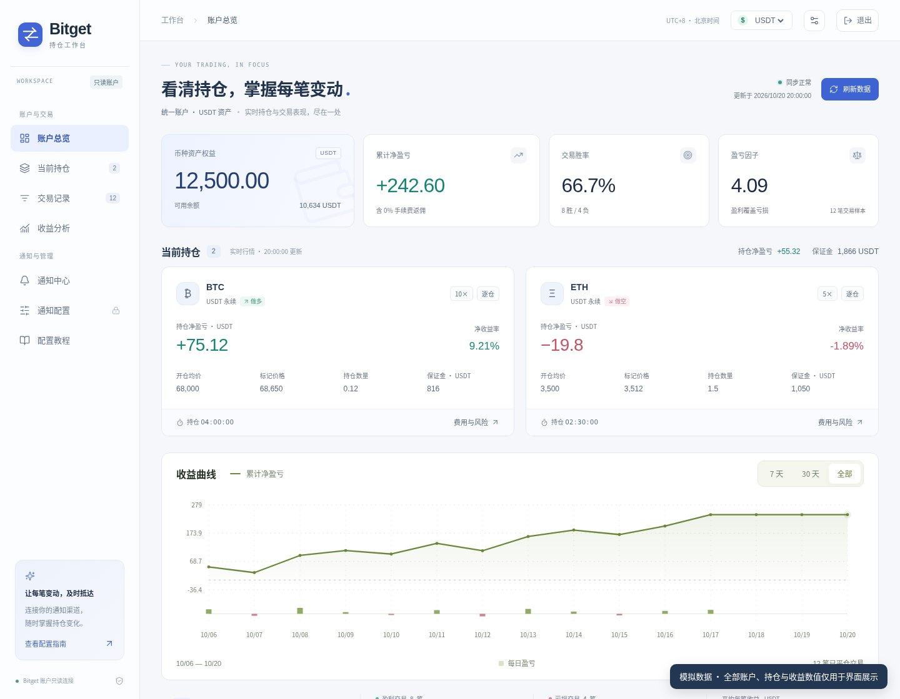
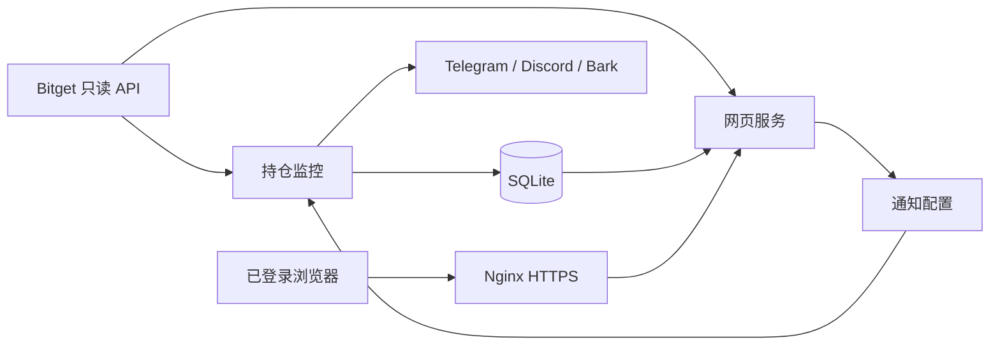
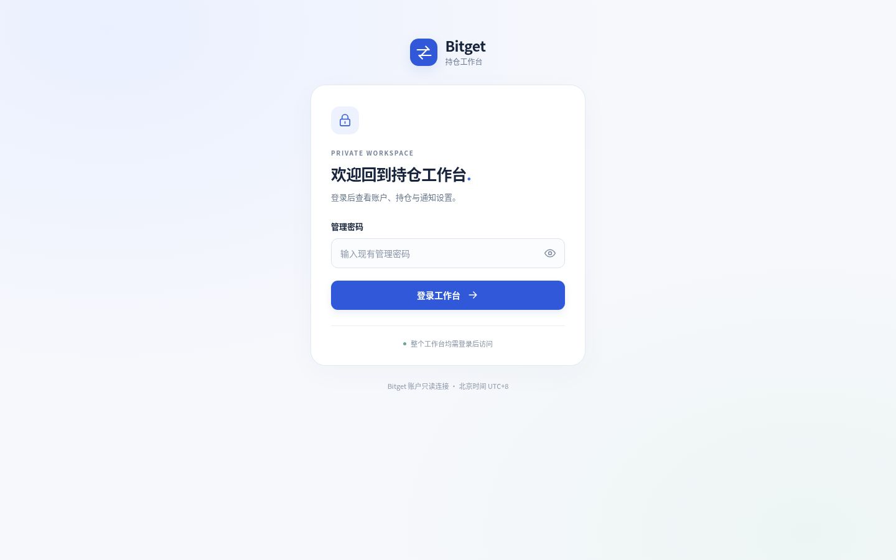

# Bitget Position Workbench

**把 Bitget 合约与 CFD 账户、持仓变化及多渠道通知放进一个私密工作台。**

Bitget Position Workbench 是一个可自行部署的只读持仓监控项目。它将账户权益、实时持仓、已平仓交易、收益统计和通知配置整合在浅色网页中，并通过 Telegram、Discord 与 Bark 提醒持仓变化。整个工作台及账户数据接口均需登录。

项目适合希望在自己的服务器管理监控与通知的个人用户。网页不提供下单、划转或提现操作，也不包含交易策略。



> 上图中的账户、持仓、价格和收益均为虚构演示数据，不对应真实账户。

[部署与启动](#部署与启动) · [通知配置教程](docs/NOTIFICATIONS.md) · [功能边界](#功能边界) · [项目结构](#项目结构)

## 能做什么

| 模块 | 内容 |
| --- | --- |
| 账户总览 | 切换合约与 CFD 账户，按结算币种分别展示权益、可用余额和交易统计 |
| 当前持仓 | 方向、数量、可确认的杠杆与保证金、标记价格或 CFD 平仓参考价、持仓或记录时长及费用详情 |
| 交易与收益 | 历史记录筛选、交易详情、收益曲线、胜率与盈亏因子 |
| 通知中心 | 最近事件、待处理情况、渠道配置状态与监控同步心跳 |
| 通知配置 | 独立启停渠道、选择交易提醒、调整持仓卡片刷新与 Bark 参数 |
| 配置教程 | Bitget 只读 API、Telegram Token / Chat ID、Discord Webhook、Bark Key 获取方法 |
| 私密访问 | 全站登录、可撤销会话、CSRF 校验、登录限流、过期退出与浏览器返回保护 |

页面适配桌面和手机。未知或暂时不可用的数据显示为“—”或错误提示，避免把读取失败误认为零余额、零收益或空仓。

### 三种通知方式

- **Telegram**：多个当前持仓合并到同一条可编辑消息，持续更新；可另外启用加仓、减仓、平仓事件。
- **Discord**：通过 Webhook 更新合并持仓消息，并发送所选交易事件；渠道可单独关闭。
- **Bark**：用于开仓方向成交提醒，包含加仓成交；支持设备 Key、声音、分组与持续响铃配置。

卡片刷新间隔与事件通知分别调度。待结算的旧平仓记录不会挡住新加减仓事件，未完成记录仍会保留并重试。 平仓等待完整结算后另发结果，关闭一个仓位不会停止其他持仓更新。

CFD 可通过 `BITGET_CFD_ENABLED=1` 单独启用，使用独立持仓接口与成交账本补查；短时间内开平仓也会核对开仓记录。配置、字段差异和匹配边界见[CFD 监控说明](docs/NOTIFICATIONS.md#cfd-监控)。

### CFD 网页账户

启用 CFD 并完成同步后，登录工作台，在“当前账户”按钮组或顶栏账户选择器中选择 **USD · CFD**。CFD 与 USDT 合约的余额、收益曲线、胜率和交易记录分别统计，不进行美元与 USDT 换算或混合累加。账户使用接口返回的结算币种。

CFD 持仓数量以“手”显示，保留 `XAUUSD.s`、`XAUUSD.pro` 等完整品种代码。报价使用多仓的 Bid 或空仓的 Ask，页面标为“平仓参考价”；持仓通过监控快照同步，页面目标读取间隔为 2 秒。缺失的保证金、收益率、手续费或净收益显示为“—”。

网页可以显示本地账本中已确认、且符合历史范围设置的旧 CFD 结算记录。查看旧历史不会改变通知启用基线，也不会补发旧单通知。费用、记录时间及访问链接的说明见 [CFD 网页展示口径](docs/NOTIFICATIONS.md#cfd-网页展示口径)。


## 技术组成

- Python 标准库提供 HTTP 服务、SQLite 存储、配置验证与会话管理。
- `websocket-client` 提供 WebSocket 支持。
- 原生 HTML、CSS、JavaScript 与 Canvas，无前端打包器或 Node.js 运行时要求。
- Nginx 提供 HTTPS 反向代理，systemd 管理监控和网页进程。
- 支持经典账户与统一账户模式；需按实际账户类型配置并核对接口可用性。



## 部署与启动

以下以 Debian / Ubuntu、Nginx、systemd，以及安装目录 `/opt/bitget-position-workbench` 为例。使用 Python 3.11 或更高版本。若安装到其他目录，请同步调整服务文件中的路径。

### 1. 准备程序

```bash
sudo apt-get update
sudo apt-get install -y git python3 python3-venv nginx
sudo git clone https://github.com/Aurivian11/bitget-position-workbench.git /opt/bitget-position-workbench
cd /opt/bitget-position-workbench
sudo python3 -m venv .venv
sudo .venv/bin/python -m pip install -r config/requirements.lock
sudo useradd --system --no-create-home --shell /usr/sbin/nologin bitgetbot
sudo cp config/.env.example config/.env
sudo install -d -m 0700 -o bitgetbot -g bitgetbot data
sudo chown -R bitgetbot:bitgetbot config
sudo chmod 0700 config
sudo chmod 0600 config/.env
```

如果 `bitgetbot` 用户已存在，跳过 `useradd`。代码目录应允许该服务用户读取与遍历；`config/` 和 `data/` 用来保存私密配置与运行数据。

### 2. 填写账户与访问配置

编辑 `config/.env`，至少填写：

| 配置 | 用途 |
| --- | --- |
| `BITGET_API_KEY` / `BITGET_API_SECRET` / `BITGET_API_PASSPHRASE` | 你自己的 Bitget 只读 API 三项凭据 |
| `BITGET_ACCOUNT_MODE` | `classic` 或 `uta`，与账户类型一致 |
| `BITGET_CFD_ENABLED` | 可选 CFD 监控，默认 `0`；启用设为 `1` |
| `BITGET_WEB_ORIGIN` | 正式 HTTPS 来源，例如 `https://monitor.example.com`，不含路径 |
| `BITGET_WEB_TRUSTED_PROXIES` | 直接连接网页进程的可信代理 IP；同机 Nginx 使用默认 `127.0.0.1,::1` |

示例默认监听 `127.0.0.1:8091`，网页固定挂载在 `/bitget/`。请使用自己的域名，不要直接沿用示例域名。容器化代理应填写其实际来源 IP，并限制网页端口的可达范围。

通知凭据默认留空、渠道关闭，可在登录后通过网页配置。手续费返佣比例默认是 `0`，只有确认自己实际享有返佣时才调整；历史范围还受 Bitget 接口可返回数据的限制。

Bitget API 只授予读取账户、持仓和历史所需权限。获取方法见[账户配置教程](docs/NOTIFICATIONS.md#bitget-账户连接)。

### 3. 创建网页管理密码

```bash
sudo -u bitgetbot .venv/bin/python -B tools/init_admin.py
```

交互输入两次密码，长度为 16–256 个字符。也可以生成随机密码：

```bash
sudo -u bitgetbot .venv/bin/python -B tools/init_admin.py --generate
```

随机密码写入本机 `config/web-admin-access.txt`，权限为 `0600`，不会打印到终端。密码哈希保存在 `config/web-admin.json`。请自行安全保管密码；这些文件不能提交到 GitHub。

### 4. 配置 HTTPS 代理

先让域名指向你的服务器并准备有效的 TLS 证书。复制 `deploy/nginx.conf.example`，按注释替换域名、证书和私钥路径，再启用对应 Nginx 站点。网页服务应只通过所信任的 HTTPS 代理访问。

```bash
sudo nginx -t
sudo systemctl reload nginx
```

`Host`、转发协议和来源元数据由代理覆盖。不要通过放宽可信代理列表来解决配置错误。直接请求 HTTP 数据接口会被拒绝，这是整站私密访问的一部分。

### 5. 启动服务

检查两个服务模板的安装目录后执行：

```bash
sudo cp deploy/bitget-position-monitor.service /etc/systemd/system/
sudo cp deploy/bitget-position-web.service /etc/systemd/system/
sudo systemctl daemon-reload
sudo systemctl enable --now bitget-position-monitor.service bitget-position-web.service
sudo systemctl status bitget-position-monitor.service bitget-position-web.service --no-pager
```

打开 `https://你的域名/bitget/`，用刚创建的网页密码登录。首次同步需要等待交易所响应；确认账户模式、余额与持仓一致后，再按需启用通知。



## 日常使用与维护

- **配置通知**：登录后进入“通知配置”，按[配置教程](docs/NOTIFICATIONS.md)填写。密钥输入框留空表示保留原值，读取接口不会返回真实密钥。
- **保存并等待生效**：有变更时，监控检测到新版本后正常退出，由 systemd 重启加载；没有实际修改的保存不会重启。
- **配置来源**：网页设置保存在 `data/web-notification-settings.json`，优先于 `config/.env` 中对应通知字段。交易所凭据仍由环境配置提供。
- **更新源码**：保留 `config/` 与 `data/`，更新代码后重建页面并重启服务。跨版本更新前先备份。
- **切换交易账户**：先备份，再使用独立数据目录或清晰的数据迁移方案，避免把不同账户的历史混在一起。

```bash
# 查看服务日志
sudo journalctl -u bitget-position-monitor.service -n 80 --no-pager
sudo journalctl -u bitget-position-web.service -n 80 --no-pager

# 修改 HTML 片段或前端资源后重建两张页面
sudo .venv/bin/python -B tools/build_web.py

# 加载代码更新
sudo systemctl restart bitget-position-monitor.service bitget-position-web.service

# 只检查网页进程是否响应；该接口不返回账户数据
curl http://127.0.0.1:8091/healthz
```

备份应包含私密配置与运行数据。SQLite 数据库运行时请使用 SQLite 的在线备份接口，或停止相关服务后复制；不要仅复制正在写入的数据库文件。备份须放在私密位置，不属于公开仓库内容。

## 功能边界

- 主进程的同步心跳表示账户监控仍在工作，**不代表每个通知渠道当前都能投递**。
- “已保存”表示配置落盘；“已生效”表示监控加载该版本并完成同步；“最近接口确认”表示平台接受请求，**不代表设备送达或已读**。
- 普通事件和 Bark 在平台可能已接受、但客户端未收到回执时会重试，因此不能保证绝对零重复。
- Bark 仅提醒开仓方向成交；不发送平仓通知。禁用期间的旧事件不会在重新启用后集中补发。
- 外部权限修复后，Discord 原 Webhook 地址不变时，需要关闭渠道保存、等待生效，再开启保存，或由管理员重启监控。
- 历史统计取决于交易所返回范围、费用完整性与配置。未结算记录可能稍后补全，统计不是交易所账单的替代品。
- 当前按个人单账户、单管理密码设计，没有多用户权限体系，也不适合作为无改造的多租户服务。
- 页面使用北京时间（UTC+8）；请保留服务器时间同步，避免交易所签名过期。

## 项目结构

```text
app/
  bot.py                         # 持仓检测、事件状态与监控入口
  aggregate_board.py             # 多持仓单消息、迁移及投递去重
  cfd_adapter.py                 # CFD 独立接口、成交账本与结算匹配
  web_app.py                     # 账户/持仓数据与网页服务
  web_admin.py                   # 全站登录、会话及管理接口
  notification_settings.py       # 通知校验、原子保存与加载确认
  telegram_*.py / discord_*.py    # 持仓卡片、事件投递与传输
  bark_*.py                      # 开仓成交队列与推送
  web/
    fragments/                   # 分页面 HTML 源码
    assets/                      # CSS、JavaScript、图标
    index.html / login.html      # 生成的工作台与登录页
config/
  .env.example                   # 仅占位示例，无真实凭据
  requirements.lock              # Python 运行依赖
deploy/                          # systemd 与 Nginx 示例
docs/
  NOTIFICATIONS.md               # 中文配置获取教程
  images/                        # 模拟数据界面和空密码登录图
tools/
  build_web.py                   # 生成 HTML 与资源版本号
  init_admin.py                  # 初始化网页管理密码
tests/                           # 隔离回归测试
LICENSES/                        # 第三方许可文本
```

运行后生成的 `config/.env`、`config/web-admin*`、`data/`、日志、虚拟环境与缓存不属于源码，已通过忽略规则排除。

## 测试

在仓库根目录执行：

```bash
PYTHONPATH=app .venv/bin/python -B -m unittest discover -s tests -v
PYTHONPATH=app .venv/bin/python -B app/test_bot.py
```

离线测试覆盖多持仓合并、CFD 快速开平仓与账本匹配、通知调度与公平队列、配置并发和无变更保存、密钥脱敏、认证与 CSRF、代理头伪造、会话撤销等。测试使用虚构凭据和隔离数据库，不发送真实通知或交易请求。

## 第三方依赖与项目关系

前端图标使用 Lucide，Python 运行依赖包括 websocket-client。第三方组件的来源与许可见 [THIRD_PARTY_NOTICES.md](THIRD_PARTY_NOTICES.md)。

本项目为独立开发的监控工具，与 Bitget、Telegram、Discord、Bark 等平台没有官方隶属关系。平台名称仅用于说明兼容的服务。
